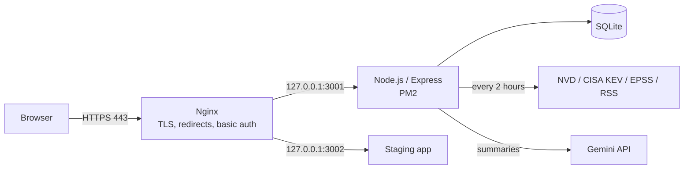

# Super Split

A cybersecurity website that puts threat intelligence, a self-assessment quiz, privacy guidance and security services in one place. Built for the **Cloud Hosting & Web Security** coursework and deployed on a self-managed Azure Ubuntu VM.

**Live site:** https://supersplit.tech

| Name | Purpose |
|---|---|
| `supersplit.tech`, `www.supersplit.tech` | Public site |
| `admin.supersplit.tech` | Admin area (Nginx password plus admin login) |
| `staging.supersplit.tech` | Staging copy (Nginx password) |

## Features

- **Threat feed:** CVEs, breach news and patch advisories from NVD, CISA KEV, EPSS and security RSS feeds. Filter by severity, vendor, industry and type. Short plain-English briefs are written by the Gemini API, and every item links to its original source.
- **Daily digest:** a five-item brief rebuilt every day at 07:00 UTC.
- **Threat level meter:** Super Split's own 0 to 100 indicator built from four public signals (see below). It is not an official alert level.
- **Posture check:** a 25-question security and SOC 2 readiness quiz with a score and bands. Signed-in users can save results.
- **Privacy hub:** a directory of privacy and digital hygiene tools, filterable by category and platform.
- **Services:** managed security and penetration testing scopes, response times and a consultation request form.
- **Accounts:** sign up, sign in and sign out, with an admin area for API keys, job status and the consultation queue.

## How the threat meter works

The score is `round(100 x sum(weight x min(1, count / baseline)))`, where the baseline is the 90th percentile of the last 30 daily counts.

| Signal | Source | Window | Weight |
|---|---|---|---|
| Known-exploited additions | CISA KEV | 7 days | 35% |
| Critical CVEs (CVSS 9.0+) | NVD | 24 hours | 25% |
| High exploit-probability CVEs (EPSS 0.5+) | FIRST EPSS | 7 days | 25% |
| Breach headlines | RSS news feeds | 24 hours | 15% |

Bands: Low (up to 20), Guarded (up to 40), Elevated (up to 60), High (up to 80), Severe (above 80). The meter shows "Calibrating" until enough history exists to replace the starting baselines.

## Architecture



- Nginx is the only public entry point. The app listens on the loopback interface only.
- Background jobs run inside the app: feed ingest every 2 hours, meter every hour at :10, digest daily at 07:00 UTC.
- SQLite stores everything in one file (`data/app.db`): users, sessions, feed items, quiz results, bookings and encrypted settings.

## Tech stack

Node.js 20+ and Express 5, SQLite (`better-sqlite3`), `bcryptjs`, `express-session` with a SQLite session store, `express-validator`, `express-rate-limit`, `helmet`, `node-cron`, `fast-xml-parser`. The front end is plain HTML, CSS and JavaScript with no build step. Hosting uses Nginx, PM2, Certbot with ZeroSSL, and GitHub Actions.

## Security

| Area | What is done |
|---|---|
| Passwords | Hashed with bcrypt (cost 12, unique salt per user). Length 10 to 72 characters, with bcrypt's 72-byte limit enforced. Plain passwords are never stored or logged. |
| Login | Generic error messages, a dummy hash for unknown emails to equalise timing, 10 attempts per 15 minutes per IP. |
| Sessions | Server-side in SQLite. The cookie `ss.sid` holds only a signed random ID, with `HttpOnly`, `SameSite=Lax` and `Secure` over HTTPS. The session ID is regenerated on login. |
| Access control | Role checked in the database on every admin request. Admin accounts are created only by a server-side script, never through sign-up. |
| Input validation | Allow-lists, length limits and type checks on every route (`express-validator`). The same rules run in the browser forms and again on the server. |
| SQL injection | Prepared statements with bound parameters only. |
| XSS and browser protections | Strict Content Security Policy and other Helmet headers, HTML escaping of all dynamic text, safe external links. |
| CSRF | JSON-only writes (415 otherwise) plus `SameSite` cookies, with no CORS headers. |
| Abuse limits | 300 API requests per minute, 5 bookings per hour, 10 admin actions per minute, and a honeypot field on the booking form. |
| Secrets | API keys saved in the Admin tab are encrypted with AES-256-GCM using `SETTINGS_SECRET`. `.env` and the database are never committed. |
| AI content | Source text is fenced as untrusted data in the prompt, and model output is stripped to plain text (no links or markup) before storage. |
| Transport | TLS 1.2 and 1.3 only, HTTP redirects to HTTPS, HSTS, a ZeroSSL certificate renewed automatically. |
| Admin and staging | Admin API blocked on the public host. The admin and staging subdomains sit behind an Nginx password. |

Known gaps: no two-factor login, email verification or password reset yet, and CSRF protection relies on `SameSite` and JSON-only writes instead of tokens.

## Getting started (local)

Requirements: Node.js 20 or newer.

```bash
git clone https://github.com/Guy0Kana/supersplit.git
cd supersplit
npm install
cp .env.example .env
```

Edit `.env` and set `NODE_ENV=development` for local use. Generate the two secrets with:

```bash
node -e "console.log(require('crypto').randomBytes(48).toString('base64url'))"
```

Run it twice and paste the results as `SESSION_SECRET` and `SETTINGS_SECRET`.

```bash
npm run create-admin -- you@example.com   # asks for a password (10 to 72 characters)
npm start                                  # http://127.0.0.1:3001
```

Optional: `npm run backfill` fills history for the threat meter, and `npm test` runs the unit tests.

## Configuration

Set in `.env` (never commit this file):

| Variable | Description |
|---|---|
| `NODE_ENV` | `production` on the server |
| `PORT` | App port (default 3001) |
| `SESSION_SECRET` | 32+ characters. Required in production. |
| `SETTINGS_SECRET` | 32+ characters. Encrypts keys saved from the Admin tab. Keep a backup: if it is lost, saved keys cannot be read. |
| `DB_PATH` | SQLite file (default `./data/app.db`). Use a different file for staging. |
| `GEMINI_API_KEY`, `GEMINI_MODEL`, `GEMINI_CAP`, `GEMINI_DELAY_MS` | Optional. These can also be set in the Admin tab. `GEMINI_CAP` is the maximum summaries per run. |
| `NVD_API_KEY` | Optional. Raises NVD's rate limit. |
| `RUN_JOBS` | `false` on staging so only production calls the external APIs |

### Gemini API

Add your key and model name in the Admin tab, then press **Test** and **Run now** on the feed job. Free-tier quotas differ per model and change over time. If a run reports HTTP 429 (quota exceeded), switch to a Flash-Lite model and lower the cap. Check [Google AI Studio](https://aistudio.google.com) for the current model names and limits.

## Deployment

1. **VM:** Ubuntu with Node.js, Nginx, PM2, Certbot and `apache2-utils`.
2. **DNS:** A records for the root, `www`, `staging` and `admin` all point to the VM's static IP.
3. **Certificate:** one ZeroSSL certificate covering all four names, issued and renewed through Certbot (ACME). A deploy hook reloads Nginx after renewal.
4. **Clone and configure:**
   ```bash
   git clone git@github.com:Guy0Kana/supersplit.git ~/super-split
   cd ~/super-split && cp .env.example .env   # fill in the secrets
   npm ci --omit=dev
   npm run create-admin -- you@example.com
   bash deploy.sh production
   ```
5. **Nginx:** copy `nginx/super-split.conf` to `/etc/nginx/sites-available/`, create the password file with `sudo htpasswd -c /etc/nginx/.htpasswd admin`, then `sudo nginx -t && sudo systemctl reload nginx`.
6. **Automatic deploys:** add the repository secrets `VM_HOST`, `VM_USER` and `VM_SSH_KEY`. A push to `main` runs the tests, then connects over SSH and runs `deploy.sh`. `deploy.sh` pulls fast-forward only, installs production dependencies and reloads PM2.
7. **Staging (optional):** a separate checkout on the `staging` branch at `~/super-split-staging`, with its own `.env` (`PORT=3002`, `DB_PATH=./data/staging.db`, `RUN_JOBS=false`).

## Project structure

```
server.js                 App entry: security headers, sessions, routes
src/
  db.js                   SQLite connection, schema and settings helpers
  crypto.js               AES-256-GCM encryption for stored keys
  settings.js             Encrypted settings and Gemini config
  middleware.js           JSON-only, validation, auth and admin checks
  routes/                 auth, feed, meter, quiz, directory, bookings, admin
  jobs/                   ingest, summarize, meter, digest, scheduler, log
  lib/                    text, meter maths, quiz scoring, http, items
config/                   Feed list and industry tagging map
data/                     Quiz questions and directory entries
public/                   Front end (index.html, style.css, app.js)
scripts/                  create-admin and smoke-test scripts
test/                     Unit tests
nginx/                    Nginx site config
.github/workflows/        CI and deploy
```

## API overview

| Method and path | Access | Purpose |
|---|---|---|
| `GET /api/meter`, `/api/feed`, `/api/feed/digest`, `/api/directory`, `/api/quiz` | Public | Read data |
| `POST /api/auth/register`, `/login`, `/logout`, `GET /api/me` | Public | Accounts |
| `POST /api/bookings` | Public (5 per hour) | Consultation request |
| `POST /api/quiz/results`, `GET /api/quiz/results` | Signed in | Save and read your own results |
| `/api/admin/*` | Admin | Status, settings, Gemini test, run jobs, bookings |

All write requests must send `Content-Type: application/json`.

## Testing

```bash
npm test                                   # unit tests
BASE=http://127.0.0.1:3001 \
ADMIN_EMAIL=you@example.com ADMIN_PASSWORD=... node scripts/smoke.js   # HTTP smoke test
```

The unit tests cover severity bands, the text sanitiser, industry tagging, meter maths, quiz scoring, feed parsing, prompt fencing and encryption. The smoke test checks sign-up and login, validation, sessions, the booking honeypot, admin gating, secret handling, rate limits and the CSP header.

## Operations

```bash
# Users, quiz results and bookings
sqlite3 -header -column data/app.db "select id, email, role, created_at from users;"
sqlite3 -header -column data/app.db "select q.id, u.email, q.overall, q.created_at from quiz_results q join users u on u.id = q.user_id;"
sqlite3 -header -column data/app.db "select id, name, email, service, created_at from bookings order by id desc;"

# Back up the database (it is the only copy of user data)
cp data/app.db ~/app-backup.db
```

Timestamps are stored in UTC (the trailing `Z`).

## Data sources and attribution

- Vulnerability data from the [National Vulnerability Database](https://nvd.nist.gov). This product uses the NVD API but is not endorsed or certified by the NVD.
- Known-exploited vulnerabilities from the [CISA KEV catalog](https://www.cisa.gov/known-exploited-vulnerabilities-catalog).
- Exploit probability scores from [FIRST EPSS](https://www.first.org/epss/).
- News and advisories from the RSS feeds listed in `config/feeds.json`. Check each source's terms of use before reuse.

## Disclaimers

- The threat meter is Super Split's own indicator and not an official alert level.
- AI-written summaries can contain mistakes. Always check the linked source before acting.
- This is a coursework project, not a production security service.

## License

MIT License
